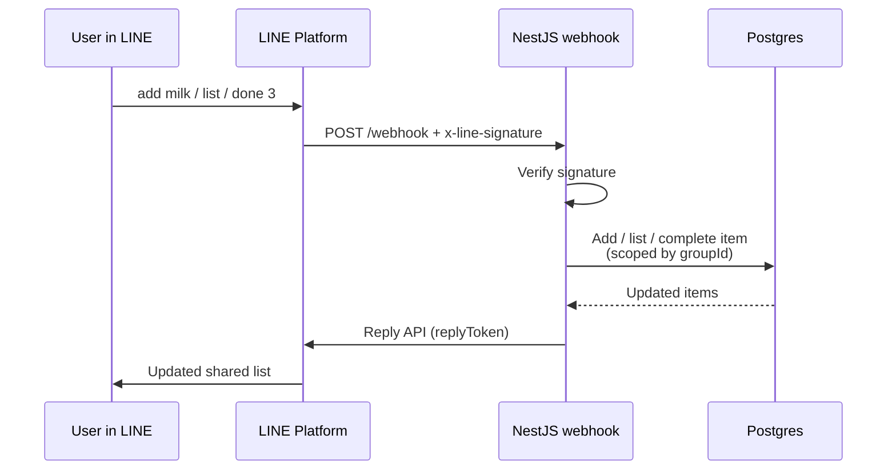
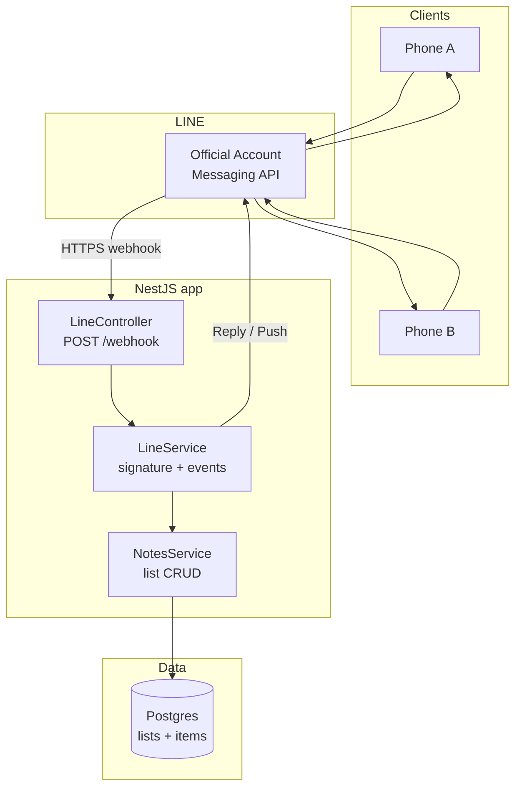
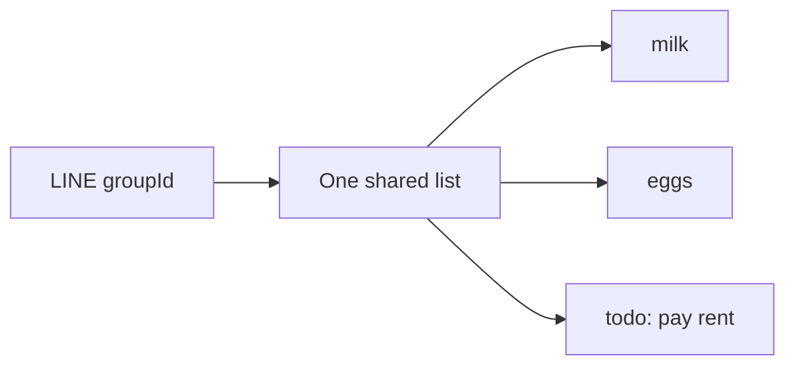

# LINE shared-notes bot — architecture

Companion to `TECH-DESIGN.md`. Diagrams first drawn in Research Bot chat (Mermaid); saved here for Manager / Nest build.

## Request flow



## Tech architecture (Nest)



## Suggested Nest module map

```
src/
  app.module.ts
  line/
    line.module.ts
    line.controller.ts      # POST /webhook
    line.service.ts         # verify, dispatch events, reply/push
    line.signature.ts
  notes/
    notes.module.ts
    notes.service.ts        # add / list / done / clear
  prisma/ or drizzle/       # schema + client
```

## Shared notes scope



## Boundaries

- Secrets stay server-side only.
- Return HTTP 200 to LINE quickly; do heavy work before reply or queue later.
- Prefer **Reply** with `replyToken` for command responses; **Push** only for reminders.
- Do not put `GameState` / MECCA patterns here — personal bot only.
